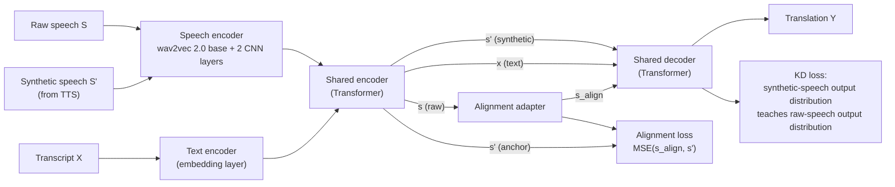

# Case Study · Speaker Voice Normalization for End-to-End Speech Translation

[← Back to repository overview](../README.md)

**Course:** 21AIE315 – AI in Speech Processing (6th semester, Section E)
**Presented:** 14 March 2024
**Team:** Mettu Siddhartha (BL.EN.U4AIE21080) and Sathyavarapu Sri Jaswanth (BL.EN.U4AIE21116)

**Paper reviewed:** Z. Xue, T. Shi, X. Zhang and D. Xiong, "Speaker voice normalization for end-to-end speech translation," *Expert Systems with Applications*, vol. 248, 2024, art. 123317. [doi:10.1016/j.eswa.2024.123317](https://doi.org/10.1016/j.eswa.2024.123317)

---

## Problem

End-to-end speech translation (ST) maps spoken source-language audio directly to target-language text, avoiding the error propagation of cascaded ASR → MT systems. But different speakers sound different (pitch, timbre, duration), and this **acoustic voice variation** makes the speech representations less consistent and hurts translation quality.

## Preliminary experiment

The authors replaced real speech with speech synthesised by a text-to-speech (TTS) system, which has no speaker variation, on the MuST-C English→German task. Training on synthetic speech was clearly better than training on raw speech:

| Task | Raw speech (BLEU) | Synthetic speech (BLEU) | Δ |
|------|------------------:|------------------------:|--:|
| ST alone | 24.1 | 28.0 | +3.9 |
| ST + ASR | 25.4 | 28.3 | +2.9 |
| ST + ASR + MT | 25.5 | 28.6 | +3.1 |

At test time there is no transcript to synthesise from, so the paper uses synthetic speech only during training, as a normalised "anchor".

## Proposed method: SVN-ST

**SVN-ST** (Speaker-Voice-Normalized Speech Translation) adds two components to a multi-task ST model:

- an **alignment adapter** on the encoder side that pulls the representation of raw speech toward the representation of its synthetic counterpart;
- a **normalized-speech knowledge distillation** module on the decoder side that guides the translation of raw speech with the translation distribution produced from synthetic speech.

### Architecture (training)

### Inference

Only the raw-speech path is used, so no TTS is needed at test time and the text encoder is dropped:

### Training objective

$$\mathcal{L} = \mathcal{L}_{ST} + \mathcal{L}_{MT} + \mathcal{L}_{ASR} + \mathcal{L}_{ST'} + \mathcal{L}_{align} + \mathcal{L}_{KD}$$

- $\mathcal{L}_{ST}$, $\mathcal{L}_{MT}$, $\mathcal{L}_{ASR}$ are the usual translation, text-translation and recognition losses.
- $\mathcal{L}_{ST'}$ is the translation loss on synthetic speech (synthetic speech is not used for the ASR loss).
- $\mathcal{L}_{align} = \lVert s_{align} - s' \rVert_2^2$ pulls the adapted raw-speech representation toward the synthetic one.
- $\mathcal{L}_{KD} = -\sum_{t}\sum_{i} p'_{t,i}\,\log p_{t,i}$ is token-level distillation, where $p'$ and $p$ are the temperature-scaled output distributions for synthetic and raw speech.

## Experimental setup

| Item | Setting |
|------|---------|
| Dataset | MuST-C English→German: about 234k sentences and 408 h of audio; `dev` for validation, `tst-common` for testing. Final experiments also cover Fr, Es, Ru, It, Pt, Ro and Nl |
| Synthetic speech | ESPnet2-TTS |
| Toolkit | fairseq |
| Speech encoder | wav2vec 2.0 base followed by two CNN layers |
| Translation model | Transformer-Base: 6 layers, 8 heads, hidden size 512, FFN size 2,048 |
| Optimisation | Adam (β₁ = 0.9, β₂ = 0.98), inverse-sqrt schedule, 25k warm-up updates, learning rate 1e-4 |
| Regularisation | Dropout 0.1, label smoothing 0.1, early stopping |
| Inference | Average of 10 checkpoints, beam size 10, length penalty 0.7 |
| Metric | Case-sensitive detokenised BLEU (SacreBLEU) |

## Results

BLEU on the MuST-C `tst-common` set, as reported in the paper:

| Model | En-De | En-Fr | En-Es | En-Ru | En-It | En-Pt | En-Ro | En-Nl | Avg |
|-------|------:|------:|------:|------:|------:|------:|------:|------:|----:|
| MTL baseline | 25.5 | 35.9 | 30.0 | 16.7 | 25.7 | 31.6 | 24.1 | 30.3 | 27.5 |
| **SVN-ST** | **26.3** | **37.2** | **30.9** | **17.8** | **26.6** | **32.4** | **25.0** | **31.0** | **28.4** |

The authors report that SVN-ST improves over previous state-of-the-art end-to-end systems that do not normalise speech by 0.4 BLEU and over cascaded systems by 2.3 BLEU, and that it is more robust than other speech-normalisation methods on the CoVoST 2 test set. Their analysis also shows that representations of the same content from different speakers become more compact.

## Takeaways

- Speaker variation is a measurable source of error in end-to-end ST, not just a nuisance for ASR.
- Normalised synthetic speech works well as a **training-time anchor**, so the extra cost of TTS is not paid at inference.
- Aligning in representation space (adapter and MSE loss) and in output space (distillation) are complementary.

## Files

| File | Description |
|------|-------------|
| `case_study_ppt.pptx` | Presentation slides |
| `Speaker voice normalization for end-to-end speech translation.pdf` | The reviewed paper |
