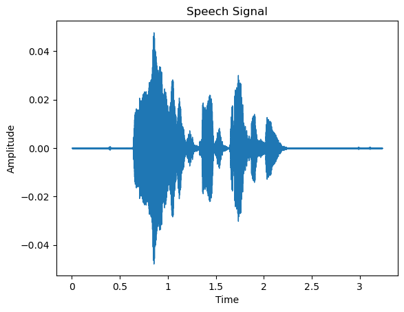

# Lab 1 · Loading, Visualising and Segmenting a Speech Signal

[← Back to repository overview](../README.md)

**Course:** 21AIE315 – AI in Speech Processing  **Author:** Mettu Siddhartha (BL.EN.U4AIE21080)

## Objective

Get hands-on with a digital speech signal: load it, plot it, measure basic properties (length, amplitude, silence) and listen to and plot selected segments.

## What was done

| # | Task | Method |
|---|------|--------|
| 1 | Load the recording and plot the waveform | `librosa.load` (mono, 22,050 Hz), `librosa.display.waveshow` |
| 2 | Measure duration and amplitude range | duration = samples / sample rate; `min` / `max` of the signal |
| 3 | Estimate total silence | count samples with \|x\| < 0.0002 and convert to seconds |
| 4 | Play and plot selected portions | slice by time (0–1 s, 1–1.5 s, 1.5–2.5 s) and render with `IPython.display.Audio` |
| 5 | Split the signal into fixed-length pieces | 1-second windows, each plotted separately |

## Results



| Quantity | Value |
|----------|-------|
| Sample rate (after `librosa.load`) | 22,050 Hz |
| Samples | 71,299 |
| Duration | 3.23 s |
| Amplitude range | −0.035 to +0.048 |
| Silence (\|x\| < 0.0002) | 1.74 s |

The waveform shows about 0.6 s of leading silence, a voiced region of roughly 1.5 s made up of several syllable-like bursts, and about 1 s of trailing silence.

## Files

| File | Description |
|------|-------------|
| `Lab01.ipynb` | Lab notebook |
| `Lab01.mp3`, `Lab01.wav` | Recorded utterance used as input |

## How to run

```bash
pip install librosa matplotlib numpy ipython jupyterlab
cd Lab1
jupyter lab Lab01.ipynb
```
