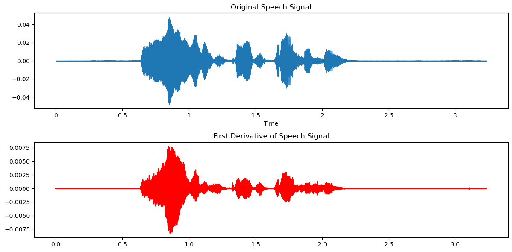
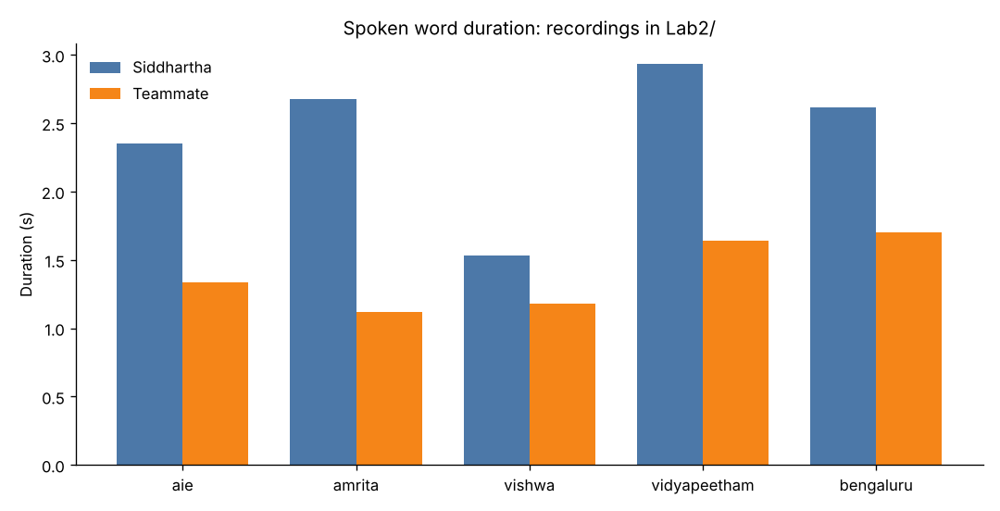

# Lab 2 · First Difference, Zero Crossings and Word Durations

[← Back to repository overview](../README.md)

**Course:** 21AIE315 – AI in Speech Processing  **Author:** Mettu Siddhartha (BL.EN.U4AIE21080)

## Objective

Analyse speech in the time domain: approximate its derivative with finite differences, examine zero-crossing behaviour, and compare recordings of the same words spoken by two people and of the same sentence spoken as a statement and as a question.

## What was done

| # | Task | Method |
|---|------|--------|
| 1 | First derivative of the speech signal | `np.diff` (first-order finite difference), plus a manual finite-difference loop; original and differenced signals plotted and played back |
| 2 | Zero crossings of the differenced signal | zero crossings located with `np.sign` / `np.diff`; gaps between consecutive crossings split at a 1,000-sample threshold into "speech" and "silence" groups |
| 3 | Word length comparison | five words (`aie`, `amrita`, `vishwa`, `vidyapeetham`, `bengaluru`) recorded by two teammates; durations computed from each file |
| 4 | Statement vs question | one sentence recorded twice (`statement.mp3`, `question.mp3`) and loaded for waveform comparison |

## Results

### Original signal and its first difference



Differencing acts as a high-pass operation: slowly varying components are suppressed and the amplitude drops by roughly a factor of six, while the syllable envelope is preserved.

### Word durations



| Word | Siddhartha (s) | Teammate (s) |
|------|---------------:|-------------:|
| aie | 2.35 | 1.34 |
| amrita | 2.67 | 1.12 |
| vishwa | 1.53 | 1.18 |
| vidyapeetham | 2.93 | 1.64 |
| bengaluru | 2.61 | 1.70 |

Siddhartha's recordings are longer than the teammate's for all five words. Durations are whole-file lengths and include leading and trailing silence, so they reflect recording length as well as speaking rate.

## Notes

- **Zero crossings:** with the fixed 1,000-sample threshold every gap fell into the "silence" group (mean gap ≈ 1.93 samples), so the speech-versus-silence contrast was not resolved. Computing the zero-crossing rate per short frame would separate the two regions more reliably.

## Files

| File | Description |
|------|-------------|
| `Lab02_AIE21080.ipynb` | Lab notebook |
| `Lab02.mp3`, `Lab02.wav` | Main recording |
| `siddhartha/`, `jaswanth/` | Per-word recordings for the two speakers |
| `statement.mp3`, `question.mp3` | Same sentence spoken as a statement and as a question |

## How to run

```bash
pip install librosa matplotlib numpy ipython jupyterlab
cd Lab2
jupyter lab Lab02_AIE21080.ipynb
```
