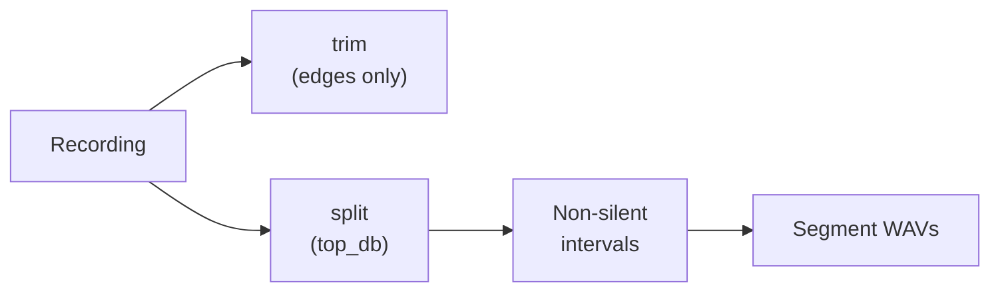
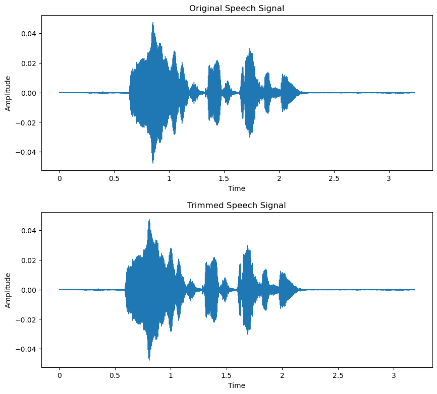

# Lab 3 · Silence Trimming and Splitting

[← Back to repository overview](../README.md)

**Course:** 21AIE315 – AI in Speech Processing  **Author:** Mettu Siddhartha (BL.EN.U4AIE21080)

## Objective

Remove silence from a recording and split speech into segments at detected pauses, then study how the `top_db` threshold changes the result.

## What was done

| # | Task | Method |
|---|------|--------|
| 1 | Remove leading and trailing silence | `librosa.effects.trim`; original and trimmed signals plotted and played back |
| 2 | Split speech at silences | `librosa.effects.split`; each segment played and its duration printed |
| 3 | Sweep the threshold | `top_db` ∈ {1, 10, 20, 40}; segments written to WAV files with `soundfile` |



## Results



With the default `top_db = 60`, trimming removes only a few hundredths of a second (3.23 s → 3.19 s), because the low-level background noise stays above that threshold. A tighter threshold trims to the speech itself:

| `top_db` | Kept span (s) | Trimmed length (s) |
|---------:|--------------:|-------------------:|
| 60 (default) | 0.05 – 3.23 | 3.19 |
| 40 | 0.37 – 2.28 | 1.90 |
| 30 | 0.60 – 2.23 | 1.63 |
| 20 | 0.60 – 2.18 | 1.58 |

The figure above uses the default setting.

Segment counts for the `top_db` sweep, loading the audio at its native 48 kHz:

| `top_db` | Segments |
|---------:|---------:|
| 1 | 1 |
| 10 | 5 |
| 20 | 4 |
| 40 | 2 |

- A very small `top_db` keeps only the loudest part of the utterance.
- Intermediate values split the speech into syllable- and word-sized pieces.
- Large values treat the gaps between words as non-silent, so neighbouring pieces merge again.

Loaded at 22,050 Hz, `top_db = 20` gives three segments of 0.70 s, 0.26 s and 0.56 s. The counts depend on the sample rate because the analysis frame length is fixed in samples.

## Files

| File | Description |
|------|-------------|
| `Lab03_AIE21080.ipynb` | Lab notebook |
| `Lab03.mp3`, `Lab03.wav` | Input recording |
| `Segments/` | WAV segments exported by the sweep (file names are reused on each run, so later `top_db` values overwrite earlier ones) |

## How to run

```bash
pip install librosa soundfile matplotlib numpy ipython jupyterlab
cd Lab3
jupyter lab Lab03_AIE21080.ipynb
```
