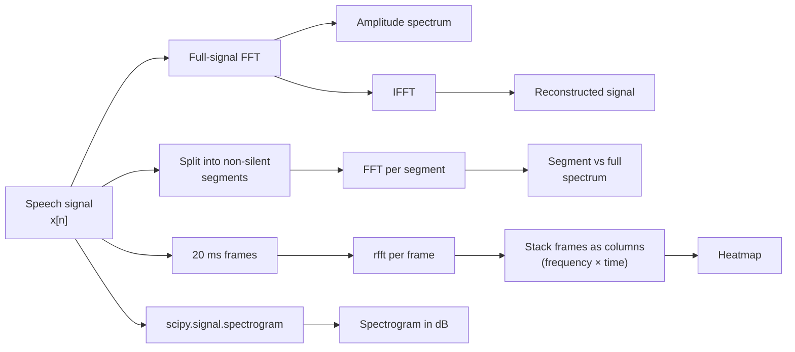
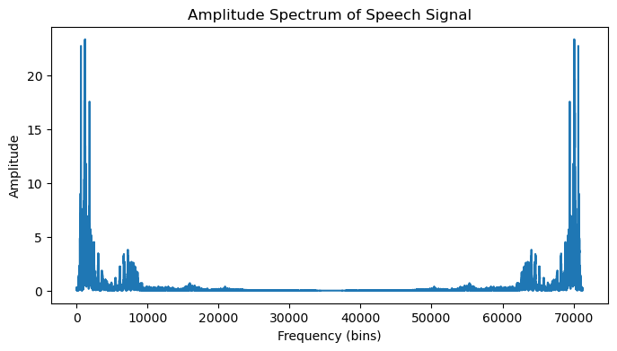
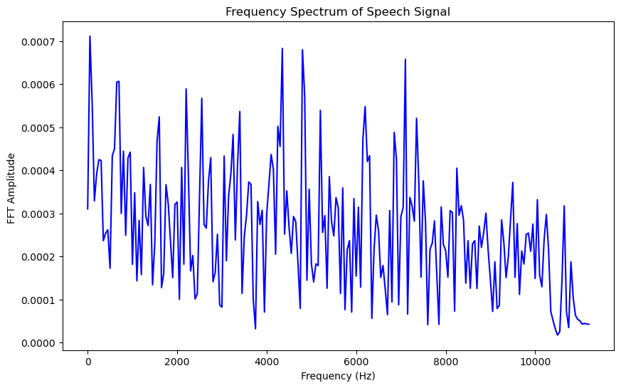
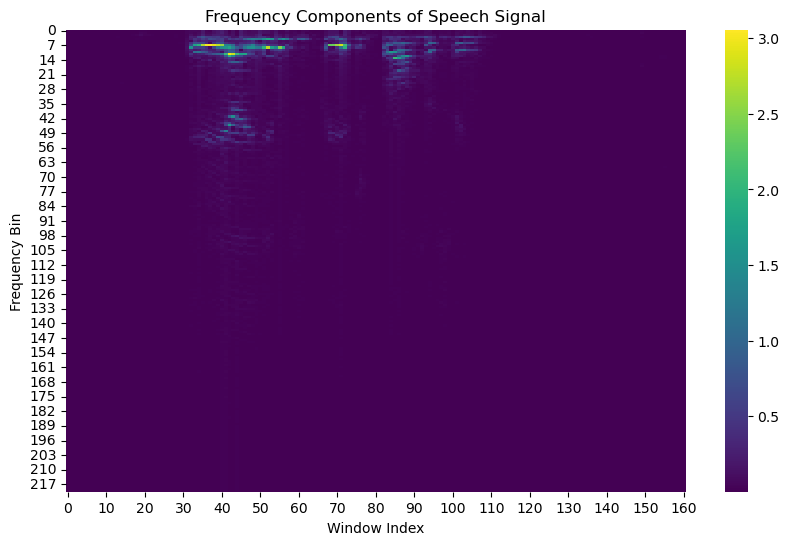
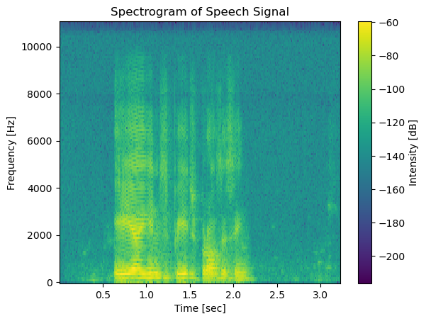

# Lab 4 · Spectral Analysis: FFT, Windowed FFT, STFT and Spectrogram

[← Back to repository overview](../README.md)

**Course:** 21AIE315 – AI in Speech Processing  **Author:** Mettu Siddhartha (BL.EN.U4AIE21080)

## Objective

Move from the time domain to the frequency domain: compute and invert the Fourier transform of a speech signal, analyse a short analysis window, and build time–frequency representations (STFT heatmap and spectrogram).

## Pipeline



## What was done

| # | Task | Method |
|---|------|--------|
| 1 | Amplitude spectrum of the full signal | `np.fft.fft`, `np.abs` |
| 2 | Inverse transform and comparison with the original | `np.fft.ifft` |
| 3 | Spectrum of a segment vs the full signal | non-silent segments found with `librosa.effects.split` (threshold from the 92nd amplitude percentile), FFT of each segment |
| 4 | Spectrum of one 20 ms rectangular window at 22.5 kHz | 450-sample window, one-sided FFT, 50 Hz bin spacing |
| 5 | Time–frequency matrix from 20 ms frames | `np.fft.rfft` on consecutive frames, stacked as columns, rendered with `seaborn.heatmap` |
| 6 | Spectrogram and comparison with the heatmap | `scipy.signal.spectrogram`, power in dB |

## Results

### 1 · Amplitude spectrum



The spectrum of a real signal is mirror-symmetric about the Nyquist frequency. Energy is dominated by components below roughly 1 kHz (the pitch fundamental and its first harmonics), with a smaller bump near 2 kHz.

### 2 · Round trip

`ifft(fft(x))` reproduces the signal: the maximum absolute error is about 7 × 10⁻⁹ and the imaginary part is numerical noise only.

### 3 · Segment spectrum

Two non-silent segments (about 0.09 s and 1.67 s) were found. Each segment's spectrum was overlaid on the full-signal spectrum.

### 4 · One 20 ms window



A 450-sample window gives 225 one-sided bins at 50 Hz spacing. With so few samples and no tapering, the spectrum is coarse and noisy, which is why speech analysis normally uses tapered windows (Hann or Hamming) and overlap.

### 5 · STFT heatmap (20 ms frames)



At 22,050 Hz, a 20 ms frame is 441 samples, giving a 161 × 221 matrix (frames × frequency bins). Energy is confined to frames 30–110 (about 0.6–2.2 s) and mainly to the lowest bins.

### 6 · Spectrogram



The spectrogram shows the same voiced region between about 0.6 s and 2.1 s. The dB scale reveals weak high-frequency content that the linear-magnitude heatmap hides.

## Files

| File | Description |
|------|-------------|
| `AIE21080_Lab04.ipynb` | Lab notebook |
| `Lab04.mp3`, `Lab04.wav` | Input recording |

## How to run

```bash
pip install librosa scipy seaborn matplotlib numpy ipython jupyterlab
cd Lab4
jupyter lab AIE21080_Lab04.ipynb
```
