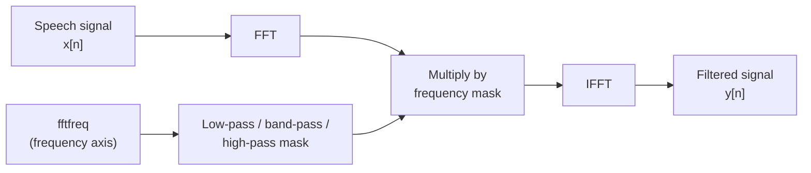
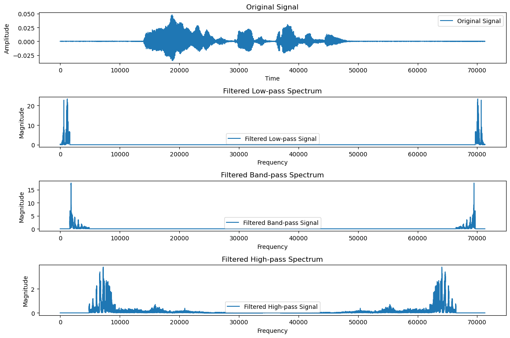

# Lab 5 · Frequency-Domain Filtering

[← Back to repository overview](../README.md)

**Course:** 21AIE315 – AI in Speech Processing  **Author:** Mettu Siddhartha (BL.EN.U4AIE21080)

## Objective

Filter speech by editing its spectrum directly: transform to the frequency domain, zero out unwanted frequency bins with a mask, transform back, and listen to the result.

## Pipeline



## What was done

| # | Task | Method |
|---|------|--------|
| 1 | Spectrum and inverse transform | `np.fft.fft`, `np.fft.ifft` |
| 2 | Ideal low-, band- and high-pass filters | binary masks on `np.fft.fftfreq` with cut-offs at 500 Hz and 1,500 Hz, then IFFT and playback |
| 3 | Repeat with cosine-based masks | masks built from `cos(π·f·c/2)`, same cut-offs |

| Filter | Pass band |
|--------|-----------|
| Low-pass | \|f\| ≤ 500 Hz |
| Band-pass | 500 Hz ≤ \|f\| ≤ 1,500 Hz |
| High-pass | \|f\| ≥ 1,500 Hz |

## Results



The top panel shows the original waveform and the others the filtered spectra. Magnitude is largest in the low band (peak ≈ 23), smaller in the 500–1,500 Hz band (≈ 17.5) and smallest above 1,500 Hz (≈ 3.8), consistent with speech energy being concentrated at low frequencies. Each filtered signal can be played back in the notebook.

## Notes

- Ideal (brick-wall) masks are simple but cause ringing in the time domain because the spectrum is cut abruptly.
- **Cosine masks (Task 3):** with the constants used, `cos(π·f·c/2)` oscillates much faster than the FFT bin spacing (0.31 Hz here), so each mask passes about half of all bins at every frequency. The three spectra therefore look alike instead of showing distinct bands. A smooth window such as a raised cosine or a Gaussian centred on the pass band would give true low-, band- and high-pass responses.

## Files

| File | Description |
|------|-------------|
| `Lab05.ipynb` | Lab notebook |
| `Lab05.mp3`, `Lab05.wav` | Input recording |

## How to run

```bash
pip install librosa matplotlib numpy ipython jupyterlab
cd Lab5
jupyter lab Lab05.ipynb
```
