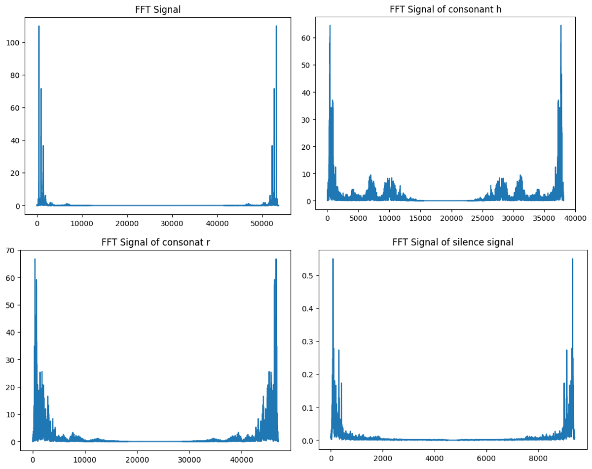
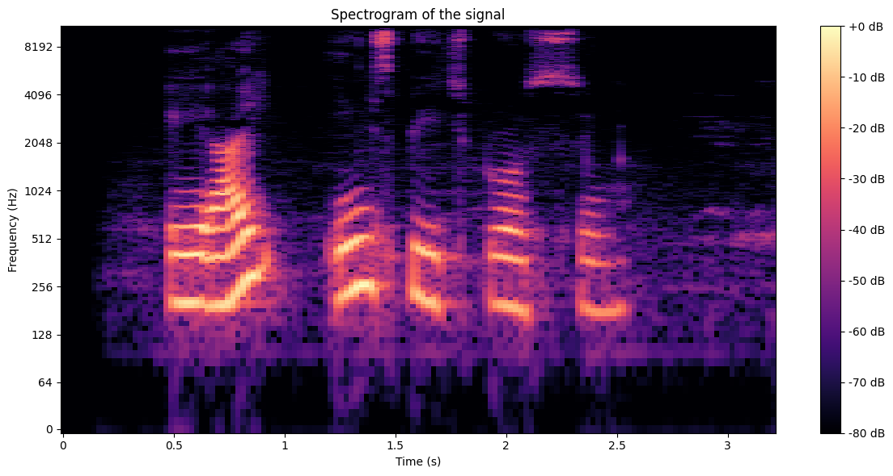

# Lab 6 · Spectral Signatures of Vowels, Consonants and Silence

[← Back to repository overview](../README.md)

**Course:** 21AIE315 – AI in Speech Processing  **Author:** Mettu Siddhartha (BL.EN.U4AIE21080)

## Objective

Compare the amplitude spectra of different speech sounds (vowels, consonants, silence and non-speech noise), then use a spectrogram to see how those sounds appear over time.

## What was done

| # | Task | Method |
|---|------|--------|
| A1 | Spectrum of vowel sounds | short recordings of the vowels **a** and **i**; waveform plus `np.fft.fft` amplitude spectrum |
| A2 | Spectrum of consonant sounds | same analysis for the consonants **h** and **r** |
| A3 | Spectrum of silence and non-voiced sound | recordings of silence and of a non-voice sound |
| A4 | Spectrogram of a full utterance | `librosa.stft` (`n_fft = 2048`, `hop_length = 512`), dB scale, log-frequency axis |

## Results

### Amplitude spectra



*Panels, left to right and top to bottom: vowel **a**, consonant **h**, consonant **r**, silence.*

- The **vowel** concentrates energy in a few sharp, low-frequency peaks (the pitch harmonics).
- The **consonants** spread energy over a wider range, with more content at higher frequencies, as expected for noise-like or partly voiced sounds.
- **Silence** has far lower magnitude than any speech sound.

### Spectrogram



Voiced (vowel-like) regions appear as stacked harmonic bands that follow the pitch contour. Noise-like consonant regions appear as diffuse bursts at higher frequencies, and the change points between them show where one sound gives way to the next.

## Notes

- The short recordings used here (`vowel_a.m4a`, `vowel_i.m4a`, `consonant-h.m4a`, `consonant-r.m4a`, `silence.m4a`, `non-voice.m4a`) and the utterance for the spectrogram (`Audio.wav`) are not stored in this repository. To re-run the notebook, record your own clips and save them under those names next to the notebook.
- Reading `.m4a` files with `librosa` requires [FFmpeg](https://ffmpeg.org/).

## Files

| File | Description |
|------|-------------|
| `Lab6_AIE21080.ipynb` | Lab notebook, with all plots saved in its outputs |
| `Lab06.mp3`, `Lab06.wav` | Recording shared with the other labs (not read by this notebook) |

## How to run

```bash
pip install librosa matplotlib numpy ipython jupyterlab
cd Lab6
jupyter lab Lab6_AIE21080.ipynb
```
