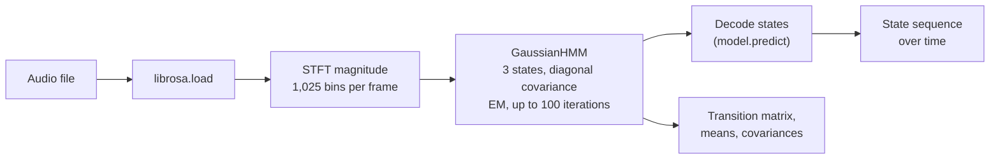
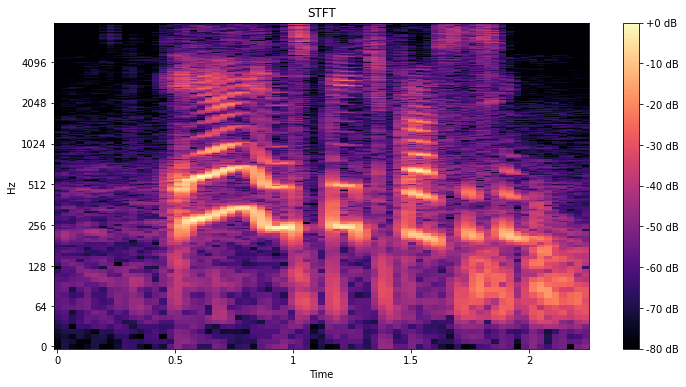
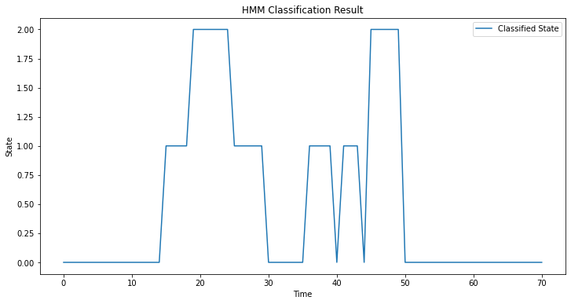

# Lab 7 · Hidden Markov Model on STFT Features

[← Back to repository overview](../README.md)

**Course:** 21AIE315 – AI in Speech Processing  **Author:** Mettu Siddhartha (BL.EN.U4AIE21080)

## Objective

Model a speech signal with a Hidden Markov Model: describe each short-time frame by its STFT magnitude, fit a Gaussian HMM, and decode the most likely hidden-state sequence over time.

## Pipeline



## What was done

| Step | Detail |
|------|--------|
| Features | `librosa.stft` magnitude, one 1,025-dimensional vector per frame |
| Model | `hmmlearn.hmm.GaussianHMM` with 3 hidden states and diagonal covariances, trained with up to 100 EM iterations |
| Decoding | `model.predict` returns the most likely state for every frame |
| Output | STFT plot, state-versus-time plot, and the learned transition matrix, means and covariances |

## Results

The figures and parameters below come from the notebook's saved run. Re-running on the bundled recording will give a different state sequence.





State 0 covers the leading and trailing low-energy regions, while states 1 and 2 alternate across the voiced part of the utterance.

Learned transition matrix (rows = from, columns = to):

| From \ To | State 0 | State 1 | State 2 |
|-----------|--------:|--------:|--------:|
| **State 0** | 0.907 | 0.070 | 0.023 |
| **State 1** | 0.188 | 0.750 | 0.063 |
| **State 2** | 0.091 | 0.091 | 0.818 |

All three states are "sticky" (self-transition probability 0.75–0.91), which matches the slowly changing character of speech frames.

## Notes

- The HMM is fit and decoded on the same recording, so this is an **unsupervised segmentation**: the states are not labelled phonemes, and there is no train/test split.
- The notebook sets no random seed, so the learned states can differ between runs.

## Files

| File | Description |
|------|-------------|
| `lab07.ipynb` | Lab notebook |
| `Lab07.mp3`, `Lab07.wav` | Input recording |

## How to run

```bash
pip install librosa hmmlearn matplotlib numpy jupyterlab
cd Lab7
jupyter lab lab07.ipynb
```

The notebook currently reads the audio from an absolute Windows path in `main()`. Change `audio_file_path` to `"Lab07.mp3"` before running.
