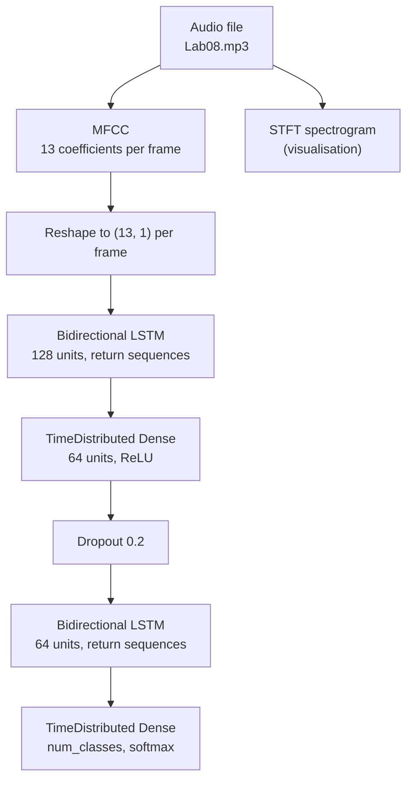
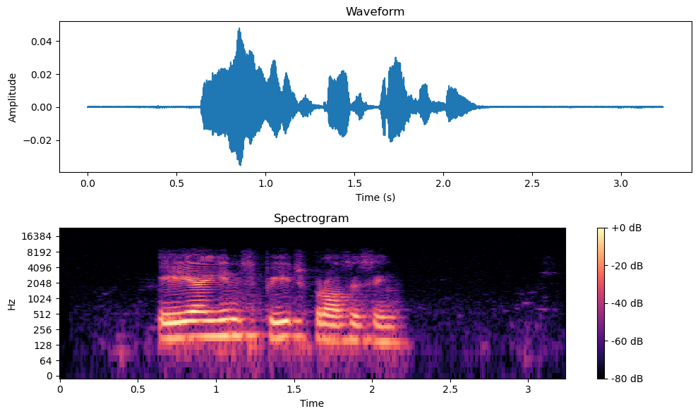
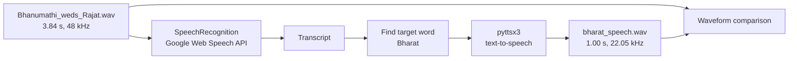
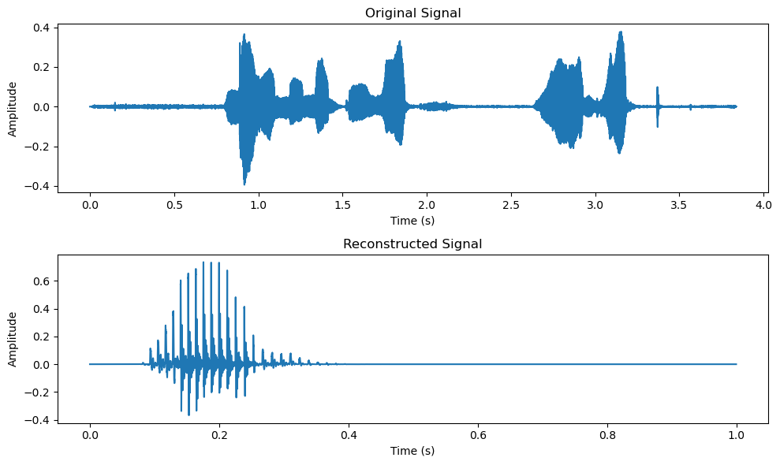

# Lab 8 · BiLSTM Speech Model and Word Synthesis

[← Back to repository overview](../README.md)

**Course:** 21AIE315 – AI in Speech Processing  **Author:** Mettu Siddhartha (BL.EN.U4AIE21080)

This lab has two parts: **A1**, a bidirectional LSTM acoustic model on MFCC features, and **A2**, building the word *"Bharat"* from the sentence *"Bhanumathi weds Rajat"* with an ASR-to-TTS pipeline.

---

## A1 · BiLSTM network for speech recognition

### Architecture



| Layer | Output size (per step) | Parameters |
|-------|-------------|-----------:|
| Bidirectional LSTM (128) | 256 | 133,120 |
| Dense (64, ReLU), time-distributed | 64 | 16,448 |
| Dropout (0.2) | 64 | 0 |
| Bidirectional LSTM (64) | 128 | 66,048 |
| Dense (softmax), time-distributed | 10 | 1,290 |
| **Total** | | **216,906** |

Compiled with the Adam optimiser and categorical cross-entropy loss.

### Input features



13 MFCCs per frame are fed to the network, and the STFT spectrogram is computed for visualisation.

### Scope

- `num_classes = 10` is a placeholder. The lab builds and summarises the architecture but does not train it; no labelled speech dataset is used.
- LPC coefficients, also named in the task, are not implemented.

---

## A2 · Synthesising "Bharat" from "Bhanumathi weds Rajat"

### Pipeline





*Top: the original recording of the sentence. Bottom: the synthesised word.*

### Discussion: issues with building a word from other words' segments

Cutting phoneme segments out of a recording and joining them to form a new word is the idea behind concatenative synthesis, and it runs into well-known problems:

- **Coarticulation.** Each sound is shaped by its neighbours, so a segment taken from one word does not fit naturally into another.
- **Prosody mismatch.** Pitch, duration and loudness differ between segments, which produces audible jumps at the joins.
- **Boundary errors.** Imprecise segmentation leaves clicks or truncated sounds, and the spectra do not match across a join.

### Scope

- The notebook performs text-driven synthesis (ASR transcript → TTS), not waveform-level concatenation of segments cut from the recording.
- Transcription calls Google's Web Speech API, so it needs an internet connection.

---

## Files

| File | Description |
|------|-------------|
| `Lab8.ipynb` | Lab notebook |
| `Lab08.mp3`, `Lab08.wav` | Recording used for the A1 features |
| `Bhanumathi_weds_Rajat.wav` | Recorded sentence for A2 |
| `bharat_speech.wav` | Synthesised output of A2 |

## How to run

```bash
pip install tensorflow librosa matplotlib numpy SpeechRecognition pyttsx3 jupyterlab
cd Lab8
jupyter lab Lab8.ipynb
```

In the A2 cells, replace the absolute Windows paths (`custom_temp_dir` and the playback path) with a local folder such as `"."`.
