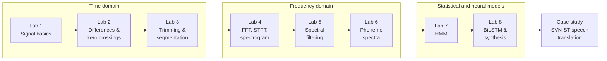

<div align="center">

# AI in Speech Processing

**Course labs and a case study on digital speech analysis, from raw waveforms to HMMs and BiLSTMs**


</div>

---

## Overview

This repository collects the lab work and case study for **21AIE315 – AI in Speech Processing** (B.Tech Artificial Intelligence, Amrita Vishwa Vidyapeetham, Bengaluru). The labs build up the speech-processing pipeline step by step:

1. inspect and segment signals in the **time domain**,
2. move to the **frequency domain** (FFT, STFT, spectrograms) and filter signals there,
3. study the **spectral signatures of phonemes**,
4. model speech statistically with **Hidden Markov Models**, and
5. model it with **recurrent neural networks** (BiLSTM).

Every lab folder has its own README with the objective, what was implemented, key results and figures, and how to run it.



## Contents

| Lab | Topic | Main techniques | Details |
|-----|-------|-----------------|---------|
| 1 | Loading, visualising and segmenting speech | `librosa.load`, waveform plots, amplitude and silence statistics | [Lab1](Lab1/) |
| 2 | Finite differences, zero crossings, word durations | First difference, zero-crossing analysis, duration comparison | [Lab2](Lab2/) |
| 3 | Silence trimming and splitting | `librosa.effects.trim` / `split`, `top_db` sweep | [Lab3](Lab3/) |
| 4 | Spectral analysis | FFT / IFFT, windowed FFT, STFT heatmap, spectrogram | [Lab4](Lab4/) |
| 5 | Frequency-domain filtering | Low-, band- and high-pass masks on the FFT, cosine masks | [Lab5](Lab5/) |
| 6 | Spectral signatures of speech sounds | Vowel, consonant and silence spectra, log-frequency spectrogram | [Lab6](Lab6/) |
| 7 | Hidden Markov Models | `hmmlearn` Gaussian HMM on STFT frames | [Lab7](Lab7/) |
| 8 | Neural speech models | BiLSTM on MFCCs, ASR-to-TTS word synthesis | [Lab8](Lab8/) |
| Case study | Speaker voice normalization for end-to-end speech translation | SVN-ST: alignment adapter and normalized-speech distillation | [Case Study](Case%20Study/) |

## Repository structure

```text
AI-in-Speech-Processing/
├── Lab1/ … Lab8/          # one folder per lab
│   ├── README.md          # objective, method, results, how to run
│   ├── LabNN_*.ipynb      # the lab notebook
│   ├── *.mp3 / *.wav      # input recordings
│   └── assets/            # figures used in the README
├── Case Study/            # paper, slides and write-up
├── requirements.txt       # Python dependencies for all labs
└── README.md
```

## Getting started

```bash
git clone https://github.com/Siddhartha80/AI-in-Speech-Processing.git
cd AI-in-Speech-Processing

python -m venv .venv
source .venv/bin/activate          # Windows: .venv\Scripts\activate
pip install -r requirements.txt

jupyter lab
```

Open a lab folder and run its notebook from that folder, because the notebooks load audio files by relative path.

**Notes**

- Labs 1–8 reuse one recorded utterance (`LabNN.mp3` / `LabNN.wav`, about 3.2 s), so results across labs are directly comparable.
- Loading `.m4a` files (Lab 6) needs [FFmpeg](https://ffmpeg.org/) on your `PATH`.
- Lab 8 needs an internet connection for Google's Web Speech API, which is used for transcription.

## Case study highlight

The case study reviews *Speaker voice normalization for end-to-end speech translation* (Xue et al., *Expert Systems with Applications*, 2024). The paper proposes **SVN-ST**, which pulls raw-speech representations toward those of synthetic (speaker-neutral) speech and distils translations from the synthetic branch to the raw branch. See the [case study write-up](Case%20Study/) for the architecture diagram and results.

## Author

**Mettu Siddhartha** (BL.EN.U4AIE21080)
[LinkedIn](https://www.linkedin.com/in/siddhartha-mettu/) · [GitHub](https://github.com/Siddhartha80)
